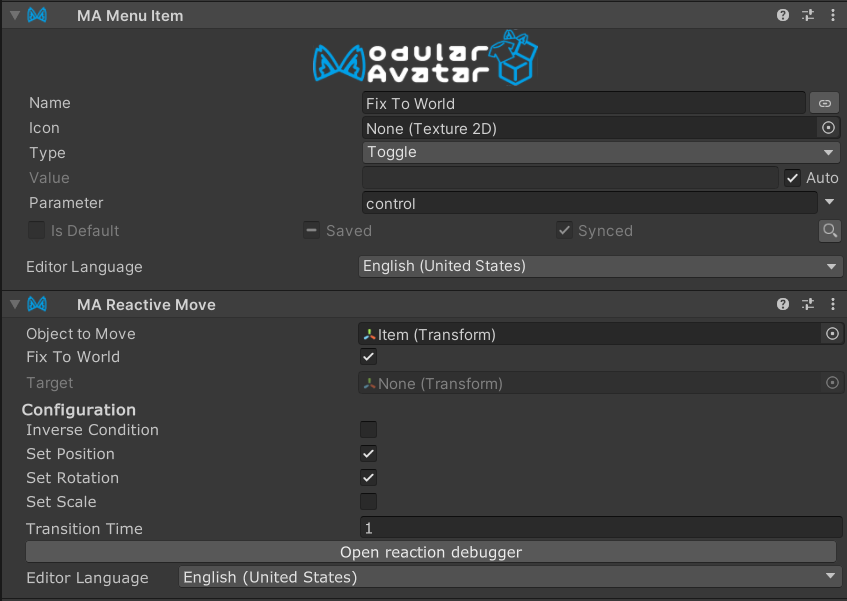

# Reactive Move

Reactive Move is a component which allows you to move an object to one of several positions,
rotations, or scale values, depending on a reaction value (e.g. menu item). It also allows you
to place objects in world space, so that they no longer move with your avatar.

On VRChat, this component will generate one or more VRC Constraints to perform this movement. 

## When should I use it?

Use this when you need to toggle the behavior of an object dynamically. For example, you might want
to toggle between an object following your hand, and an object at a fixed position in world space.

## When shouldn't I use it?

If the object needs to always follow the target, consider using [Bone Proxy](../bone-proxy.md).

If the object needs to move to the target's position, but does not need to follow the object thereafter,
use [Move To](../move-to.md).

## How to use

Attach a `Modular Avatar - Reactive Move` to the menu item you want to use to control the movement.
Set the "Object to Move" to the object that you will control, and "Target" to the object to move to.
Or, use "Fix to world" to make the object stay in place.

:::tip

If you need to offset the position or rotation, create a child object of the target, and set Target
to that child.

:::

For advanced use cases, you can adjust "Set Position"/"Set Rotation"/"Set Scale" to only track certain
aspects of the target. You can also set "Inverse Condition" to enable the Reactive Move only when the
parent is _not_ selected.

Setting Target to empty when not setting "Fix To World" will result in the object returning to its original
position/rotation/scale.

### Example of use

A fully worked example can be found in the Modular Avatar package, under the name `ReactiveMove_FixToWorldExample`.

### Transition times

If you set a nonzero transition time, then the object will smoothly move to its new position, over
approximately the specified number of seconds.

:::note

During this time, the object will not precisely follow the target; avoid setting excessively long times here.

:::

### Treatment when multiple Reactive Moves are active

If multiple Reactive Moves are active, then for each of position, rotation, and scale, the last active Reactive Move
(in hierarchy order) for each object to move will be used.