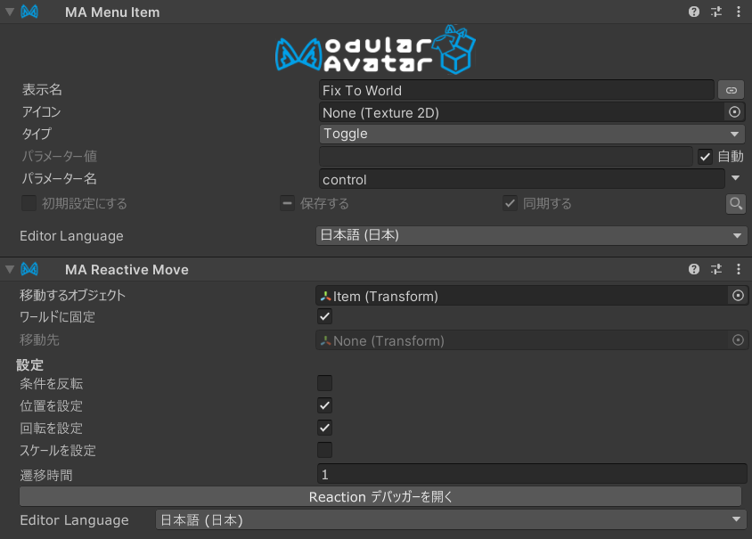

# Reactive Move

Reactive Move とは、オブジェクトを幾つかの位置、回転、大きさで姿勢を、Menu Item などのリアクション
に応じて変動させることができるコンポーネントです。また、オブジェクトをアバターに連動せずにワールドに固定することも
できます。

VRChat では、いくつかの VRC Constraint を生成して、この動作を実現します。

## いつ使うべきか？

オブジェクトの姿勢を動的に変える必要がある場合に使いましょう。たとえば、手を追うオブジェクト姿勢と、
ワールドに固定した姿勢を切り替える場合など。

## 非推奨の場合

特定のオブジェクトが特定のターゲットを常に追う場合、[Bone Proxy](../bone-proxy.md)も検討しましょう。

ターゲットの位置に移動した後、連動して動く必要がない場合、[Move To](../move-to.md)を使いましょう。

## 使い方

`Modular Avatar - Reactive Move` を、制御用 Menu Item に着けましょう。
`移動するオブジェクト` に移動させるオブジェクトを入れて、`移動先` をその移動先にしましょう。
また、ワールドに固定する場合は `ワールドに固定` を選択しましょう。

:::tip

位置、回転などにオフセットをつける場合、移動先の子を作って、`移動先` にその子を指定しましょう。

:::

高度な使い方として、「位置を固定」「回転を固定」「スケールを固定」で、一部の要素だけ制御することができます。
また、「条件を反転」で、メニューアイテムが選択されてない時に発火できます。

`ワールドに固定` を設定せずに `移動先` を空にした場合、オブジェクトが元の位置に戻ります。

### 使用例

Modular Avatar のパッケージに、`ReactiveMove_FixToWorldExample` という名前のサンプルがあるので、ご確認ください。

### 遷移時間

`遷移時間` に秒数を設定すると、**おおよそ**指定した時間で新しい位置に移動します。

:::note

遷移中は、移動先を完璧に追うことができないため、長すぎない時間設定にしましょう。

:::

### 複数の Reactive Move が起動したときの扱い

複数の Reactive Move が起動した場合、位置、回転、スケールそれぞれにおいて、特定の
`移動するオブジェクト` でヒエラルキー順で最後に起動している Reactive Move が採用されます。